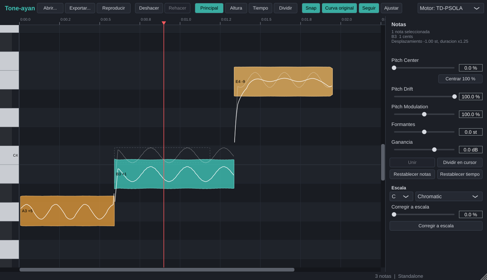

# Tone-ayan

Editor de afinación por notas al estilo Melodyne, en formato **VST3 para Windows** (también incluye una app Standalone y una herramienta de línea de comandos).
No es un autotune en tiempo real. Tone-ayan analiza una grabación monofónica (voz o instrumento de una sola línea) y muestra cada nota como un bloque en un piano roll.
Puedes mover cada bloque libremente: cambiar su altura, su posición en el tiempo y su duración, aplanar la deriva, reducir o exagerar el vibrato, desplazar formantes o corregir hacia una escala.
La resíntesis TD-PSOLA conserva los formantes, así que no aparece el efecto ardilla.



## Instalación en Windows

**Opción A: descargar el build del CI**
1. En GitHub ve a **Actions → tone-ayan**, abre la última ejecución en verde y descarga el artefacto `Tone-ayan-Windows`.
2. Copia la carpeta `Tone-ayan.vst3` a `C:\Program Files\Common Files\VST3\`.
3. En tu DAW, vuelve a escanear los plugins.

El artefacto también trae `Tone-ayan.exe` (Standalone), `tone-ayan-cli.exe`, un WAV de demostración y su versión editada.

**Opción B: compilar tú mismo**
Necesitas Visual Studio 2022 (con "Desarrollo para el escritorio con C++"), CMake ≥ 3.22 y Git.

```bat
cd tone-ayan
build-windows.bat
```

El script descarga JUCE 8, el ARA SDK, Catch2 y nlohmann/json, compila en Release, ejecuta los tests e indica dónde quedan los archivos.

## Cómo usarlo

### 1. Con ARA (recomendado): Studio One, Cubase/Nuendo, REAPER, Cakewalk/Sonar
Inserta Tone-ayan como extensión ARA en la pista; en REAPER, por ejemplo, el plugin se marca como ARA en el FX browser.
El DAW le entrega el audio completo de cada clip, sin necesidad de grabar nada.
Selecciona un clip en el DAW y el editor muestra sus notas.
Las ediciones se guardan dentro del proyecto del DAW (archivo ARA) y se reproducen en su posición.

### 2. Modo captura (cualquier host VST3)
1. Inserta Tone-ayan en la pista.
2. Pulsa **Capturar** y reproduce el tramo en el DAW. Lo que pasa por el plugin se graba, anclado a la línea de tiempo del DAW.
3. Detén el DAW. Tone-ayan analiza la toma; la barra inferior muestra el progreso.
4. Edita. Al volver a reproducir, el plugin sustituye la toma original por la versión editada en esa misma posición. Fuera del tramo capturado, el audio pasa sin cambios.

Con **Abrir...** puedes cargar un archivo en lugar de capturar; se coloca en el segundo 0 del proyecto.
El audio capturado, el análisis y las ediciones se guardan en el estado del plugin (audio en FLAC sin pérdidas), así que se conservan con el proyecto.

### 3. Standalone
Abre `Tone-ayan.exe` y carga un WAV, AIFF, FLAC, MP3 u OGG con **Abrir...**.
Reproduce con **Reproducir** o con la barra espaciadora. Haz clic en la regla para mover el cursor.
**Exportar...** guarda el resultado como WAV de 24 bits.

### Herramientas

| Acción | Cómo |
|---|---|
| Mover altura | Arrastrar el bloque en vertical. Con **Snap**, ajusta a semitonos; con **Alt**, mueve libre en cents |
| Mover en el tiempo | Arrastrar en horizontal. El primer movimiento decide el eje; con **Ctrl**, ambos ejes a la vez |
| Estirar o encoger | Arrastrar el borde izquierdo o derecho del bloque |
| Dividir nota | Doble clic sobre la nota, o herramienta **Dividir** |
| Unir notas | Seleccionar notas contiguas y pulsar **Unir** (tecla `M`) |
| Selección múltiple | Shift/Ctrl + clic, o arrastrar en vacío (rectángulo) · `Ctrl+A` todas · `Esc` ninguna |
| Transponer | `↑`/`↓` un semitono · `Shift` una octava · `Alt` 10 cents |
| Pitch Center | Deslizador (0–100 %) que acerca el centro de cada nota al semitono; **Centrar 100 %** lo aplica de golpe |
| Pitch Drift | 100 % = deriva original; 0 % = aplanada |
| Pitch Modulation | 100 % = vibrato original; 0 % = sin vibrato; 200 % = exagerado |
| Formantes / Ganancia | Por nota, en semitonos / dB |
| Escala | Tónica + tipo (mayor, menores, modos, pentatónicas, blues) y el deslizador **Corregir a escala** (0–100 %). Actúa sobre la selección o, si no hay, sobre todas |
| Restablecer | `Supr` restablece las notas seleccionadas · **Restablecer tiempo** devuelve todas a su posición |
| Deshacer / Rehacer | `Ctrl+Z` / `Ctrl+Y` (o `Ctrl+Shift+Z`). Historial completo |
| Zoom / scroll | Rueda = vertical · `Shift`+rueda = horizontal · `Ctrl`+rueda = zoom de tiempo · `Alt`+rueda = zoom de altura · `F` = ajustar |

Al mover una nota en el tiempo, las notas pegadas a ella (legato) se estiran o encogen para seguir unidas, y los huecos absorben el resto, como en Melodyne.
La línea discontinua marca la posición original de la nota y la curva tenue es la curva de altura original.

## Herramienta de línea de comandos

Sirve para validar el DSP sin abrir un DAW:

```bat
tone-ayan-cli demo demo.wav                                rem frase cantada sintética, algo desafinada
tone-ayan-cli analyze demo.wav proyecto.json               rem lista las notas y guarda el proyecto
tone-ayan-cli render demo.wav examples\edits.json out.wav  rem aplica ediciones y escribe el WAV
tone-ayan-cli render demo.wav proyecto.json out.wav --engine pv
tone-ayan-cli compare demo.wav examples\edits.json         rem compara PSOLA y vocoder de fase (error en cents)
```

`edits.json` puede ser un proyecto completo (el que escribe `analyze`, editable a mano) o una lista de ediciones por índice de nota:

```json
{
  "scale": { "root": "A", "type": "Natural Minor" },
  "edits": [
    { "notes": "all", "correctToScale": 1.0 },
    { "notes": "all", "drift": 0.3 },
    { "note": 2, "modulation": 0.4 },
    { "note": 3, "pitch": 2.0 },
    { "note": 4, "time": 0.08 },
    { "note": 6, "stretch": 1.3 },
    { "note": 1, "formant": 1.5, "gain": -2.0 },
    { "note": 5, "split": 0.5 },
    { "notes": [0, 1], "merge": true },
    { "note": 0, "setPitch": 57 },
    { "notes": "all", "center": 0.5 }
  ]
}
```

## Arquitectura

```
tone-ayan/
  src/core/            sin JUCE: se compila en segundos y se prueba sin interfaz
    common/            FFT radix-2, utilidades, paralelismo, E/S WAV y binaria
    model/             Note, Project, Scale, comandos de edición, UndoStack, JSON       -> tone_model
    analysis/          pYIN, onsets, segmentación, pitch marks, Analyzer             -> tone_analysis
    engine/            TimeMap, EditModel, PSOLA / vocoder de fase, Renderer con caché -> tone_engine
  src/plugin/          JUCE: procesador, EditSession (hilos de análisis y render),
                       captura, estado, editor
    ara/               DocumentController, AudioModification y PlaybackRenderer ARA2
  src/ui/              piano roll, inspector y look & feel
  tests/               Catch2 (núcleo) + tests/plugin (procesador, captura, estado, editor)
  tools/               tone-ayan-cli
```

Las dependencias van en un solo sentido: `common ← model ← analysis ← engine ← plugin/ui`.

**El modelo no es destructivo.** Cada nota guarda su rango de origen y su altura analizada, que nunca cambian, y aparte sus parámetros de edición: desplazamiento, posición y duración destino, deriva, modulación, formantes y ganancia.
Undo y redo guardan instantáneas completas del proyecto, que pesa pocos kB.

**Polifonía futura.** El análisis produce una lista de notas por fuente, y el renderer suma unidades independientes.
Añadir varias voces por fuente (`vector<NoteTrack>`) no cambia la interfaz del motor ni el formato de las notas.

### Pipeline de análisis (offline, en un hilo de fondo con progreso)

1. **pYIN**, implementado desde el artículo de Mauch & Dixon (2014), con hop de 5 ms.
   - La función de diferencia es **simétrica** (retardo hacia delante y hacia atrás), de modo que el centro efectivo coincide con el frame para cualquier periodo. Así la estimación no se retrasa con vibrato ni glissandos.
   - Los umbrales se ponderan con una distribución beta (2, 18).
   - Un HMM de voicing de 2 estados decide voz/no voz, y un Viterbi de altura (bins de 10 cents) se ejecuta dentro de cada tramo con voz.
   - El resultado es f0, confianza y voicing por frame.
2. **Segmentación.**
   - Se rellenan huecos sin voz de ≤ 30 ms y se descartan fragmentos de < 40 ms.
   - Los cortes se proponen por cambio de altura (media de ±200 ms, que promedia el vibrato), por caídas de energía de ≥ 6 dB (re-articulaciones) y por picos de flujo espectral.
   - Después se fusionan las notas demasiado cortas o con la misma altura.
   - Cada nota guarda inicio, fin y mediana; la curva y la amplitud se leen del track.
3. **Pitch marks.** Se coloca una marca por periodo glotal, rastreada desde el periodo más fuerte en ambas direcciones con una penalización de desviación, para que las marcas mantengan una fase coherente.

### Motor de resíntesis

- **TD-PSOLA** con ventanas Hann asimétricas centradas en las marcas.
  - Cambiar el pitch cambia el espaciado entre granos, pero no su contenido, por eso los formantes se conservan.
  - El formant shift remuestrea cada grano.
  - Se compensa la sonoridad (1/√ratio) y el time-stretch se hace por mapeo temporal.
  - En las zonas no editadas, las marcas de síntesis se re-anclan a las de análisis, por lo que el audio sin tocar se reproduce idéntico (error < −30 dB en los tests).
- **Partes sin voz** (consonantes, respiraciones): overlap-add mapeado en el tiempo, sin cambio de pitch. Se mezclan con la capa con voz mediante una máscara suave derivada de las marcas.
- **Transiciones**: entre notas contiguas, el desplazamiento, los formantes y la ganancia hacen crossfade con un coseno sobre ±30 ms. La curva de pitch resultante es continua, sin saltos.
- **Drift y Modulation**: la curva de cada nota se descompone en centro, deriva lenta (media móvil doble de 150 ms) y modulación (el resto). Cada componente se escala de forma independiente.
- **Caché por unidad**: la línea de tiempo se corta en unidades (una por nota y una por hueco) que se unen con crossfades complementarios.
  - Cada unidad se identifica por el hash de todo lo que la afecta.
  - Tras editar una nota solo se vuelven a renderizar ella y sus vecinas; el resto sale de caché.
  - El render corre en un hilo propio, se cancela si llega una edición nueva y conserva las unidades ya terminadas.
- **Alternativa evaluada: vocoder de fase** con envolvente espectral "true envelope" (cepstral iterativa, con lifter adaptado al f0). Se elige desde el editor o con `--engine pv`.
  `tone-ayan-cli compare` mide ambos motores. Los dos aciertan la altura (≤ 2.4 cents en la demo).
  PSOLA conserva mejor los formantes: 0.5–0.7 dB de error medio por armónico frente a la envolvente original, contra 1.5–2.9 dB del vocoder (un remuestreo simple daría unos 7–8 dB).
  Además PSOLA es unas 20 veces más rápido. Por eso es el motor por defecto.

### Tiempo real

El hilo de audio solo lee un buffer ya renderizado:
- Las versiones nuevas se publican con un puntero atómico (`SnapshotPublisher`), y las antiguas se liberan fuera del hilo de audio cuando ningún lector las usa.
- La captura escribe en bloques preasignados por el hilo de mensajes alrededor del cursor (`CaptureRecorder`).
- En ARA, la exclusión frente a las ediciones del grafo del host se hace con un contador atómico.
- En `processBlock` no hay **ni asignaciones de memoria ni locks**.
- La latencia es 0.

## Calidad y pruebas

`ctest` ejecuta 29 suites. Los tests del núcleo usan Catch2 y señales sintéticas de frecuencia conocida.

| Área | Qué se comprueba |
|---|---|
| pYIN | Senos de 82–1046 Hz y sierras band-limited de 87–784 Hz: **error máximo < 5 cents** por frame. Vibrato y glissando < 10 cents. Silencio y ruido como sin voz |
| Segmentación | Legato de 6 notas (número de notas, centros < 10 cents, límites < 25 ms), notas separadas por silencio o ruido, re-articulación a la misma altura, vibrato fuerte que sigue siendo una sola nota |
| Pitch marks | Una marca por periodo, espaciado regular |
| Modelo | Transposición, centro, escala, mover y estirar con vecinas pegadas y límites, dividir, unir, undo/redo exacto, JSON ida y vuelta |
| Resíntesis | Desplazamientos de −12 a +12 st: **la altura medida coincide con el objetivo (< 5 cents)** en PSOLA y en el vocoder de fase. Formantes conservados (error < 3 dB respecto a la envolvente original y menos de la mitad del de un remuestreo; PSOLA mide 0.5–0.7 dB). Formant shift intencionado. Partes sin voz intactas. Stretch de ×1.5. Drift y modulation. Reconstrucción exacta sin ediciones. La caché solo re-renderiza lo cambiado |
| Plugin | Standalone (abrir, editar, reproducir), modo captura con un playhead de host simulado (paso directo, finalización al parar, sustitución en la posición correcta, paso directo fuera del clip), guardar y restaurar el estado, estado corrupto sin fallo, apertura y redimensionado del editor |
| pluginval | **Strictness 10: SUCCESS** |

El CI (`.github/workflows/tone-ayan.yml`) compila en Windows y Linux, ejecuta todos los tests, el CLI y pluginval, y publica el paquete.

## Licencias

| Componente | Licencia |
|---|---|
| JUCE 8 | AGPLv3 o comercial. Para distribuir binarios sin publicar el código hace falta una licencia JUCE |
| ARA SDK 2.2 (Celemony) | Apache 2.0 |
| Catch2 v3 | BSL-1.0 (solo tests) |
| nlohmann/json | MIT |
| pYIN, PSOLA, vocoder, FFT, segmentación | Implementación propia (sin código GPL; ni Rubber Band ni el pYIN de Vamp) |

## Limitaciones conocidas (v1)

- Solo audio **monofónico**. Los acordes o las voces dobladas se analizan como una sola línea.
- El modo ARA está implementado contra la API de JUCE/ARA y compila, pero no se ha probado dentro de un DAW real (aquí no hay host ARA). Si tu DAW muestra algún problema, cuéntalo indicando el DAW y la versión.
- El modo captura reemplaza la toma anterior si vuelves a capturar (no fusiona pasadas).
- Las ediciones de tiempo mueven las notas dentro del clip y no cambian la duración del clip en el DAW.
